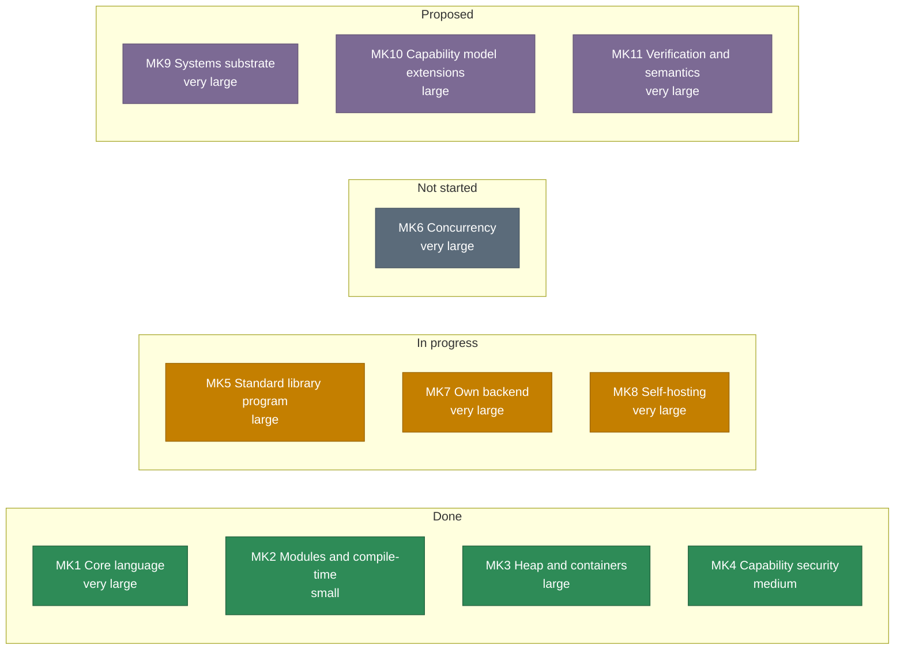
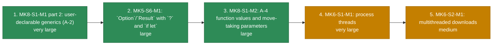

# Roadmap

Kelp's milestones are **marks** (a named goal), **stages** (a significant part of a mark) and **stages' milestones**; the hierarchy and the identifier rules are in [`plan/roadmap.md`](https://homelabone.xenoo.dev/gittea/Juniper/kelp/src/branch/main/plan/roadmap.md), which is the authority for everything on this page.

Generated from `plan/roadmap.md` at `kelp` commit `175b0e3` by `tools/roadmap.py` in the wiki repository — re-run it and commit the result when the roadmap moves. The diagrams show order and status, not calendar time: the roadmap has no dates, because a mark moves when its prerequisites land rather than on a schedule.

## The marks at a glance

| Mark | What it is | Stages | Size | Status |
| --- | --- | --- | --- | --- |
| **MK1** | Core language | S1 syntax, S2 types/codegen, S3 ownership, S4 borrowing | very large | Done |
| **MK2** | Modules and compile-time | S1 multi-file/substitution, S2 compile-time features | small | Done |
| **MK3** | Heap and containers | S1 owned buffers, S2 containers | large | Done |
| **MK4** | Capability security | S1 capabilities | medium | Done |
| **MK5** | Standard library program | S1-S7, S4b, S4c | large | In progress: MK5-S1, MK5-S2 (M1 `io` + `process`, M2 `spawn_in`/`run_in`, the fallible `try_run`, and `fs.sym… |
| **MK6** | Concurrency | S1 threads, S2 multithreaded downloads | very large | Not started |
| **MK7** | Own backend | S1-S5 | very large | In progress |
| **MK8** | Self-hosting | S1-S3 language readiness, S4-S6 bootstrap | very large | In progress: MK8-S1-M1 part 1 (tagged unions + pattern `when`) and part 2 (A-2, generics) both done, A-3 ship… |
| **MK9** | Systems substrate | S1-S9 | very large | Proposed |
| **MK10** | Capability model extensions | S1-S3 | large | Proposed |
| **MK11** | Verification and semantics | S1-S4 | very large | Proposed |

## The critical path

Five milestones, in order — 3 of them done. Each is here because the one before it is a prerequisite, or because the payoff is what the rest of the list exists for. Everything else is in the open items or the backlog.

| # | Milestone | Size | Why it is next |
| --- | --- | --- | --- |
| ~~1~~ | **MK8-S1-M1 part 2: user-declarable generics (A-2)** | very large | Done. Type parameters on `datac`/`enum`/`fun`, monomorphization at every use site, inference from arguments and the expected type, receiver methods on a generic type, explicit type arguments, and a `Map` with a real key type. Open item 34 is resolved, and row 2 is unblocked: `Option<T>`/`Result<T, E>` payloads, `datac Pair<A, B>` and `Map<i32, V>` all work. |
| ~~2~~ | **MK5-S6-M1: `Option`/`Result` with `?` and `if let`** | large | Done. `if let` desugars to a single-arm `when` over a bound scrutinee; `?` works on any enum shaped `Ok`/`Err` or `Some`/`None`; `std/option` and `std/result` ship the two enums and their helpers; and every stdlib error `datac` is now an `Option` or a `Result`. Every fallible stdlib API wanted it (`List.index_of`, `Map.get`, `str.parse_*`, `Box.take`, `net.recv`), and the preparatory work (the error-`datac` convention, `errno` in panic text) had already made the migration mechanical. |
| ~~3~~ | **MK8-S1-M2: A-4 function values and move-taking parameters** | large | Done — phases A-F, which close A-4. `move T` (open item 1's spelling), function values typed `fun(i32).R: i32`, `fun` literals, captures (a literal that names an enclosing binding becomes a `closure(T).R: U` — a function value plus the heap environment its captures were moved into, and a plain function value is widened into one where a closure is expected), and the stdlib callbacks (`option`/`result`/`std/list`) taking closures, so MK5-S7-M1's two prerequisites for threads are met. The `Copy`-only helpers are not part of this row: they need A-11's partial moves. |
| 4 | **MK6-S1-M1: process threads** | very large | The owner's chosen order: threads before concurrent downloads. Needs row 3, a per-thread panic and cleanup story, and atomics plus a published memory model, which the plan places in MK9-S3-M1 (see Dependency notes). |
| 5 | **MK6-S2-M1: multithreaded downloads** | medium | The payoff of row 4: N URLs in flight, one process, one pool per worker. |

## Named, not scheduled

Real work that is not next: nothing here is a question (those are the open items) and nothing here is a commitment (those are the marks).

| Item | Blocked on | Note |
| --- | --- | --- |
| MK5-S4b-M1, TLS for `https` | open item 37 (link the system TLS library, or ship `http`-only) | The missing piece is the decision, not the work. |
| MK5-S4c, multi-fd `poll` | nothing | The off-ramp for row 4 above, and the honest concurrency answer v1 already ships for one thread. |
| MK7, the language's own backend | nothing | A stated goal in its own right, with a measured argument (compile time) and a measured cost (runtime). |
| MK8-S2, MK8-S3 | MK8-S1 | Ergonomics and scale for self-hosting. |
| MK8-S4 to MK8-S6 | MK8-S3 | The bootstrap test itself. |
| MK9, MK10, MK11 | each other; see Dependency notes | Plan-level commitments. No program demands them yet. |

## See also

- [Source documents](source-documents.md) — which file is the authority for what
- [Known issues](known-issues.md) — what is broken today, with repros
- [Compiler](../compiler/index.md) — the pipeline the milestones extend
