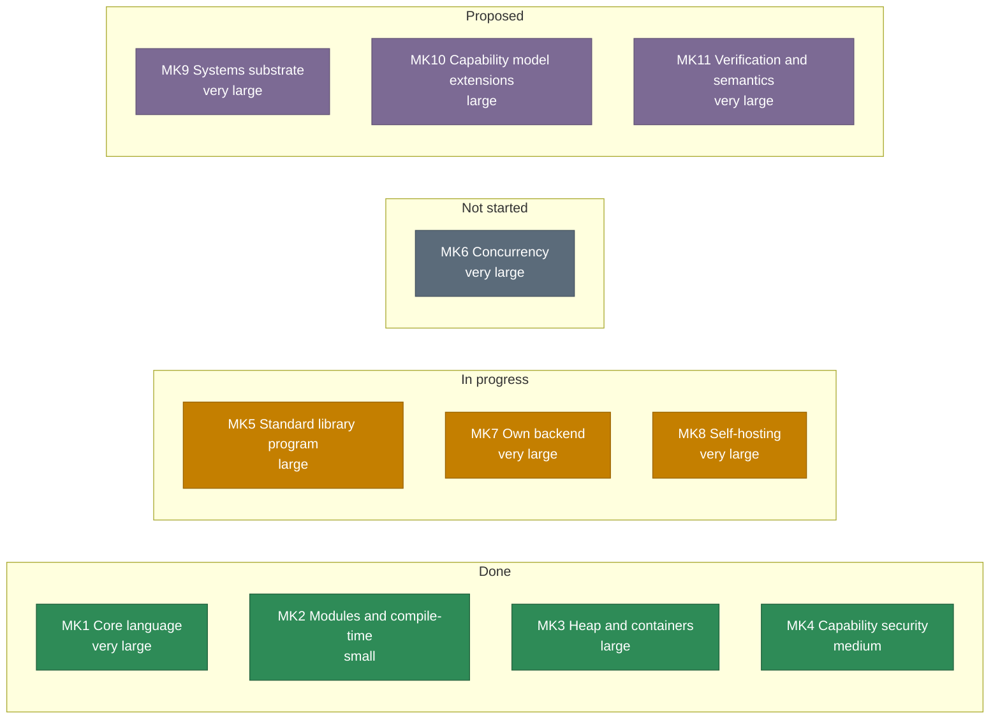

Kelp is a statically typed, compiled systems language whose headline feature is
**capability-based security**. A module declares what it may touch, and that
authority is part of the source and checked at every call site that uses it.

```kelp
impl "std/http" with caps(net = ["127.0.0.1:*"])
impl "std/fs"

fun main() {
    print("a program that may talk to 127.0.0.1 and touch the filesystem")
}
```

Those two `impl` lines are the program's entire network and filesystem
authority. There is no other place authority can be acquired: a program cannot
read a file, open a socket, spawn a process or read the clock unless the module
making the call was granted that resource. "What can this code do?" is answered
by the first few lines of a file instead of by auditing it.

## Where to start

<div class="grid cards" markdown>

-   **New to Kelp**

    ---

    Read [Getting started](/getting-started): the language in one page,
    then a program, a tool with an exit code, and tests around it.

-   **The language**

    ---

    The [Language chapter](/language) is the reference for the surface
    syntax: types, control flow, functions, ownership, capabilities.

-   **The standard library**

    ---

    [Standard library](/stdlib) documents every `std/*` module and the
    compiler builtins (`String`, `Bytes`, `List`, `Map`, `Box`).

-   **Working on the compiler**

    ---

    [Compiler](/compiler) covers the pipeline, the two backends, the
    runtime and the test gates. [Contributing](/meta/contributing) has the
    workflow.

-   **Libraries**

    ---

    [Libraries (fpl)](/libraries) is the first-party library catalogue:
    JSON, CSV, TOML, base64, dates, sets, bit packing, big integers, decimals,
    HTTP helpers and more.

-   **Release history**

    ---

    [Changelog](/changelog) records every `kelpc` release: what the language
    and the compiler gained, version by version. [Coral](/tooling/coral-changelog)
    and [Lighthouse](/tooling/lighthouse-changelog) have their own.

</div>

<!-- roadmap:start -->
## Roadmap

Of the 11 marks, **4 are done**, **3 in progress** (MK5, MK7, MK8) and 4 planned or proposed. The critical path is next at **MK6-S1-M1**: process threads. No dates: the milestones are ordered by dependency, not by calendar. A
mark moves when its prerequisites land, and `plan/roadmap.md` is the record.



[The full roadmap](/meta/roadmap) has every mark's scope and status, the
five-row critical path, and what is named but not scheduled. Generated from
`plan/roadmap.md` at `kelp` commit `940c524`.
<!-- roadmap:end -->

## What the language has

| | |
| --- | --- |
| Types | `i32` `i64` `u8` `u16` `u32` `u64` `usize` `isize` `f32` `f64` `bool` `char`, plus borrowed text as `str` and `View` |
| Data | `datac` records with `val`/`var` fields, `enum` tagged unions, exhaustive `when`, `if let`, type parameters, `const`, `pd` passdowns |
| Ownership | owned builtins `String`, `Bytes`, `List<T>`, `Map<K, V>`, `Box<T>`; moves, shared and `mut` borrows, drops at end of scope, no garbage collector |
| Errors | `Option`, `Result`, the `?` operator, `panic`/`assert` |
| Functions | `fun`, named arguments, function values and closures, receiver methods, stdlib-only argument-type overloading |
| Modules | `impl "std/fs"`, local-file imports, aliases, `pd` passdowns |
| Capabilities | `fs`, `net`, `process`, `env`, `time`, `rand` |
| Stdlib | `mem` `str` `path` `math` `fmt` `io` `fs` `process` `net` `http` `time` `rand` `env` `list` `option` `result` |
| Toolchain | `kelpc` (compiler), [Coral](/tooling) (build tool and package manager), [Lighthouse](/tooling) (editor support) |

There is deliberately **no** `unsafe`, no exceptions, no undefined-behaviour
escape hatch, no garbage collector, and no macros.

## A program

```kelp
datac Point(var x: i32, var y: i32)

enum Shape {
    Circle(val r: f64)
    Rect(val w: f64, val h: f64)
    Empty
}

fun area(s: &Shape).R: f64 = when s {
    Circle(r) -> 3.14159 * r * r
    Rect(w, h) -> w * h
    Empty -> 0.0
}

fun main() {
    var p = Point(x = 3, y = 4)
    p.x = 10
    print("point ${p.x},${p.y}")

    print("area ${area(Shape.Circle(r = 2.0))}")
    print("area ${area(Shape.Rect(w = 3.0, h = 4.0))}")

    var xs: List<i32> = List.empty()
    xs.push(7)
    xs.push(35)
    print("sum ${xs.get(i = 0) + xs.get(i = 1)}")
}
```

```
point 10,4
area 12.566360
area 12.000000
sum 42
```

## How this documentation relates to the repository

The authoritative in-repo documents are the `plan/*.md` files in the
[Kelp repository](https://homelabone.xenoo.dev/gittea/Juniper/kelp): `syntax.md`
is the syntax and style authority, `architecture.md` is the design,
`roadmap.md` is the plan, `done.md` is the milestone record. This wiki is a
web-friendly view of them, with the standard library and the library catalogue
added; where they disagree, the plan document wins and the page has a bug.

See [Source documents](/meta/source-documents) for the map.

## Repositories

The project lives in Gitea, at
[`homelabone.xenoo.dev/gittea/Juniper`](https://homelabone.xenoo.dev/gittea/Juniper).

| Repository | What it holds |
| --- | --- |
| [`kelp`](https://homelabone.xenoo.dev/gittea/Juniper/kelp) | The compiler `kelpc` in Rust, plus the `plan/*.md` documents that are the authority for the language. |
| [`fpl`](https://homelabone.xenoo.dev/gittea/Juniper/fpl) | One folder per first-party Kelp library: `argparse`, `bigint`, `csv`, `json` and the rest of the catalogue. |
| [`coral`](https://homelabone.xenoo.dev/gittea/Juniper/coral) | The build tool and package manager. |
| [`lighthouse`](https://homelabone.xenoo.dev/gittea/Juniper/lighthouse) | Editor support: the LSP server, the VS Code extension and the IntelliJ plugin. |
| [`kelp-wiki`](https://homelabone.xenoo.dev/gittea/Juniper/kelp-wiki) | The sources for this documentation. `main` is the MkDocs source; the `wikijs` branch is what this wiki imports. |

All repositories, including the ones unrelated to Kelp:
[homelabone.xenoo.dev/gittea/Juniper](https://homelabone.xenoo.dev/gittea/Juniper).
