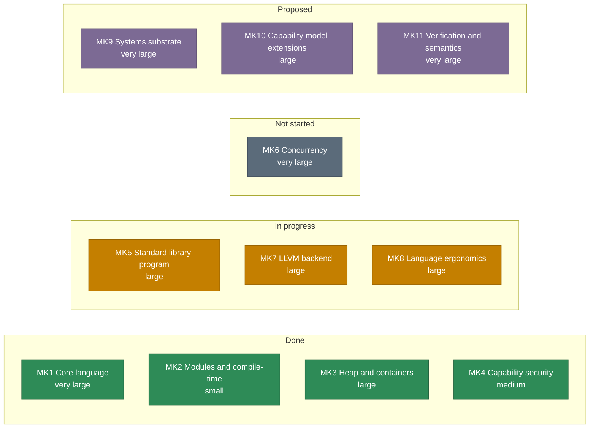
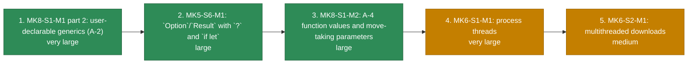

Kelp's milestones are **marks** (a named goal), **stages** (a significant part of a mark) and **stages' milestones**; the hierarchy and the identifier rules are in [`plan/roadmap.md`](https://homelabone.xenoo.dev/gittea/Juniper/kelp/src/branch/main/plan/roadmap.md), which is the authority for everything on this page.

Generated from `plan/roadmap.md` at `kelp` commit `59c9abe` by `tools/roadmap.py`, which lived in this repository's MkDocs-era layout and is kept at branch `mkdocs-archive` and tag `mkdocs-final`, not in the current tree: re-run it from there and commit the result when the roadmap moves. The diagrams show order and status, not calendar time: the roadmap has no dates, because a mark moves when its prerequisites land rather than on a schedule.

## The marks at a glance

| Mark | What it is | Stages | Size | Status |
| --- | --- | --- | --- | --- |
| **MK1** | Core language | S1 syntax, S2 types/codegen, S3 ownership, S4 borrowing | very large | Done |
| **MK2** | Modules and compile-time | S1 multi-file/substitution, S2 compile-time features | small | Done |
| **MK3** | Heap and containers | S1 owned buffers, S2 containers | large | Done |
| **MK4** | Capability security | S1 capabilities | medium | Done |
| **MK5** | Standard library program | S1-S7, S4b, S4c | large | In progress: MK5-S1, MK5-S2 (M1 `io` + `process`, M2 `spawn_in`/`run_in`, the fallible `try_run`, and `fs.sym… |
| **MK6** | Concurrency | S1 threads, S2 multithreaded downloads | very large | Not started |
| **MK7** | LLVM backend | S0-S7 | large | Direction changed: the hand-written `asm` track was retired on 2026-09-20 and its source removed on 2026-09-21 (`plan/asm-backend/` holds its plans and measurements), and the plan of record is LLVM IR (`plan/mk7-llvm-backend.md`): the backend seam (S0) is done, and S1 (`llvm` selectable over the scalar subset, byte-identical stdout on the scalar fixtures) landed on 2026-09-21, then S2A (the `datac` record slice) and S2B (the heap: `Bytes`/`String` through the runtime, an owned field, the drop plan, `panic`/`assert`, and the C runtime text given one home in `kelpc/runtime/kelp_rt.c`) landed on the same day; S2C to S7 remain, weeks of emission-layer work, 3 to 6 weeks to a suite-green backend |
| **MK8** | Language ergonomics and scale | S1-S3 | large | In progress, and re-scoped (the rewrite stages S4 to S6 are cancelled permanently): MK8-S1-M1 part 1 (tagged unions + pattern `when`) and part 2 (A-2, generics) both done, A-3 ship… |
| **MK9** | Systems substrate | S1-S9 | very large | Proposed; planned |
| **MK10** | Capability model extensions | S1-S3 | large | Proposed; planned |
| **MK11** | Verification and semantics | S1-S4 | very large | Proposed; planned |

## The critical path

Five milestones, in order: 3 of them done. Each is here because the one before it is a prerequisite, or because the payoff is what the rest of the list exists for. Everything else is in the open items or the backlog.

| # | Milestone | Size | Why it is next |
| --- | --- | --- | --- |
| ~~1~~ | **MK8-S1-M1 part 2: user-declarable generics (A-2)** | very large | Done. Type parameters on `datac`/`enum`/`fun`, monomorphization at every use site, inference from arguments and the expected type, receiver methods on a generic type, explicit type arguments, and a `Map` with a real key type. Open item 34 is resolved, and row 2 is unblocked: `Option<T>`/`Result<T, E>` payloads, `datac Pair<A, B>` and `Map<i32, V>` all work. |
| ~~2~~ | **MK5-S6-M1: `Option`/`Result` with `?` and `if let`** | large | Done. `if let` desugars to a single-arm `when` over a bound scrutinee; `?` works on any enum shaped `Ok`/`Err` or `Some`/`None`; `std/option` and `std/result` ship the two enums and their helpers; and every stdlib error `datac` is now an `Option` or a `Result`. Every fallible stdlib API wanted it (`List.index_of`, `Map.get`, `str.parse_*`, `Box.take`, `net.recv`), and the preparatory work (the error-`datac` convention, `errno` in panic text) had already made the migration mechanical. |
| ~~3~~ | **MK8-S1-M2: A-4 function values and move-taking parameters** | large | Done, phases A-F, which close A-4. `move T` (open item 1's spelling), function values typed `fun(i32).R: i32`, `fun` literals, captures (a literal that names an enclosing binding becomes a `closure(T).R: U`, a function value plus the heap environment its captures were moved into, and a plain function value is widened into one where a closure is expected), and the stdlib callbacks (`option`/`result`/`std/list`) taking closures, so MK5-S7-M1's two prerequisites for threads are met. The `Copy`-only helpers are not part of this row: they need A-11's partial moves. |
| 4 | **MK6-S1-M1: process threads** | very large | The owner's chosen order: threads before concurrent downloads. Needs row 3, a per-thread panic and cleanup story, and atomics plus a published memory model, which the plan places in MK9-S3-M1 (see Dependency notes). |
| 5 | **MK6-S2-M1: multithreaded downloads** | medium | The payoff of row 4: N URLs in flight, one process, one pool per worker. |

## Named, not scheduled

Real work that is not next: nothing here is a question (those are the open items) and nothing here is a commitment (those are the marks).

| Item | Blocked on | Note |
| --- | --- | --- |
| MK5-S4b-M1, TLS for `https` | open item 37 (link the system TLS library, or ship `http`-only) | The missing piece is the decision, not the work. |
| MK5-S4c, multi-fd `poll` | nothing | The off-ramp for row 4 above, and the honest concurrency answer v1 already ships for one thread. |
| MK7, the LLVM backend | nothing (the backend seam, the S1 scalar subset, the S2A `datac` slice and the S2B heap slice are done) | Stages S2C to S7 remain: the containers, the tagged union and borrowed views, the stdlib's `extern fun` bodies and the capability check, DWARF, fuzzing and the optimization-level decision before the default can flip. A real backend rather than an own one: LLVM supplies the optimizer, DWARF, sanitizers and the targets. `plan/mk7-llvm-backend.md` owns the plan. |
| MK8-S2, MK8-S3 | MK8-S1 | Language ergonomics and compiler scale. The rewrite stages (MK8-S4 to MK8-S6) are cancelled permanently. |
| MK9, MK10, MK11 | each other; see Dependency notes | Plan-level commitments. No program demands them yet. |

## See also

- [Source documents](/meta/source-documents): which file is the authority for what
- [Compiler](/compiler): the pipeline the milestones extend
